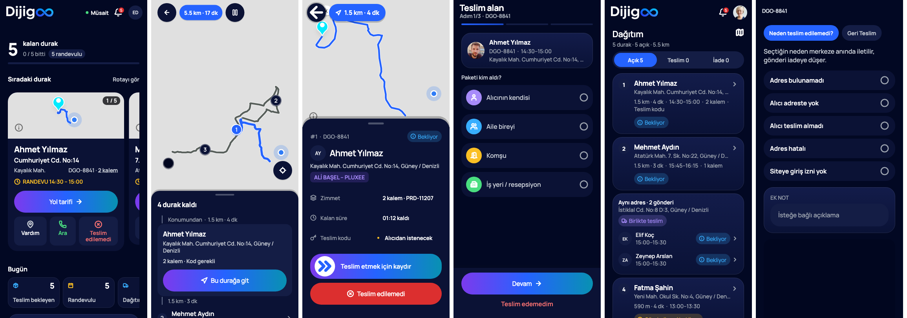
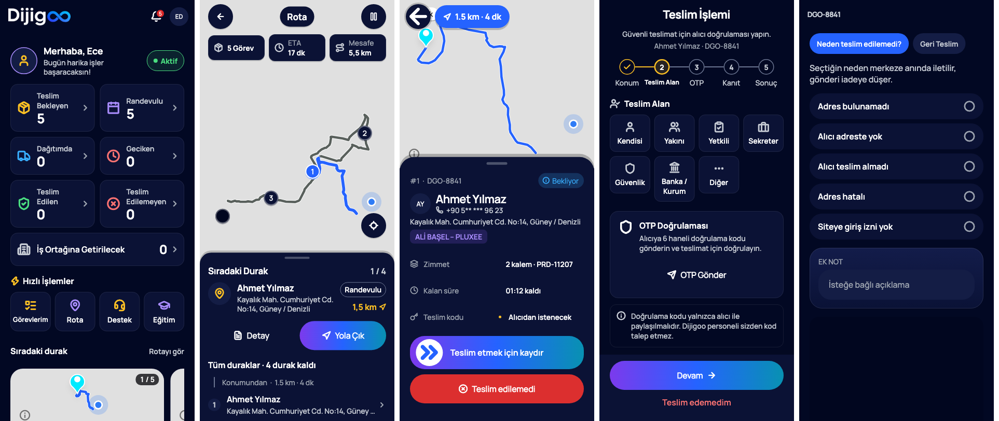

# V3 kapsam analizi, ekran güncellemesi ve test raporu (2026-11-16)

Kaynak: `Kurye_App_Final_Surec_Teknik_Kabul_V3.docx` (WhatsApp'tan gelen kopyayla birebir aynı) ve `JetDiji_Sube_Kurye_Developer_Handoff_FINAL` paketi (K01–K14).

Durum: **commit edilmedi**. Birlikte test sonrası commitlenecek.

Kapsam: biz **mobil uygulamayı** yapıyoruz. Panel ve canlı API (`api-mobile.jetdiji.com`) JetDiji ekibinin; oraya düşen işler aşağıda ayrı listede, JetDiji'ye iletilecek.

## Bu oturumda yapılanlar

| Talep | Yapılan | Dosya |
|---|---|---|
| Ana sayfada dashboard görünmüyor | K01 düzeni: selam + Aktif çipi, 6 sayaç (2 sütun), tam genişlikte "İş Ortağına Getirilecek", Hızlı İşlemler (Görevlerim, Rota, Destek, Eğitim). Sayaçlar ilk ekranda. | `screens/home_screen.dart` |
| Rota akışı tasarımdan farklı | K04: üstte Görev / ETA / Mesafe çipleri, geofence çipi (500 m varsayılan), altta "Sıradaki Durak n/N" kartı, hizmet tipi, uzaklık, Detay + Yola Çık. Yola Çık görevi dağıtıma alır ve navigasyonu açar. | `screens/shell_screen.dart`, `courier_home.dart` |
| Teslimat işlemleri tasarımdan farklı | K05: 5 adımlı ilerleme (Konum, Teslim Alan, OTP, Kanıt, Sonuç), V3 §3.1 teslim alan seçenekleri, "Diğer" için ad/ilişki/açıklama zorunlu, OTP kartı (Gönder, 6 hane, gerçek 02:00 sayaç, 3 gönderim limiti, limitte Merkez Destek), güvenlik notu, "Teslimi Tamamla". Hata mesajı düğmenin üstünde. | `screens/wizard_screen.dart` |
| "Ara" alıcı numarasını açıyor | Panel `ORIGINATED` dönerse santral arar. Panel alıcının kendi numarasını dönerse çevirici **açılmaz**; uyarı verilir. Ham numaraya düşen yedek yol kaldırıldı. Görev detayında numara maskeli (+90 5** *** 34 27). | `courier_home.dart`, `session.dart`, `task_detail_screen.dart` |
| Barkod alanına mikrofonla dikte | Tarama panelinde mikrofon (önceki oturum) + panel formundaki barkod/kargo kodu alanlarına mikrofon. Türkçe dil ayarı. "seksen sekiz", "on iki" gibi sayılar çözülüyor. | `barcode_voice.dart`, `visit_flow_screen.dart` |
| Teslim edilemedi neden kodu kayboluyordu | Panel listesinden seçilen nedenin kodu aynen gider. Önce Vefat, Hasarlı, Mücbir vb. hepsi 9302 "alıcı yok" gidiyordu. | `api/courier_tasks.dart`, `session.dart` |
| V3 §4.1 kanıt kuralları | Vefat: fotoğraf yok, açıklama zorunlu. Hasarlı: fotoğraf + açıklama. Mücbir/kimlik: fotoğraf zorlanmaz. Diğer: açıklama zorunlu. | `api/courier_tasks.dart`, `return_screen.dart` |
| Rehberli akışta çift kayıt riski | Yeniden denemede aynı idempotency anahtarı gider, başarıdan sonra silinir (UAT-14). | `session.dart` |
| Zorunlu arama (UAT-05) | Ulaşılamadı / adreste yok / kabul etmedi / randevu nedenlerinde önce "Müşteriyi Ara" denemesi gerekir. Santral bugün bağlanmadığı için kural "deneme yapıldı" olarak kondu. | `return_screen.dart`, `visit_flow_screen.dart` |
| K03 Zorunlu Adımlar | Görev detayında 6'lı ızgara: konum (500 m), arama, işleme başla, OTP, kanıt, sonuç. Gerçek durumdan işaretlenir, bilgi amaçlı. | `task_detail_screen.dart` |
| Kart teslimi kimlik bayrağı | Her kart görevinde sıfırlanıyor (önce ilk karttan sonra hep geçiyordu). | `session.dart` |

Önce / sonra (koyu tema, 375 px):

## Swagger sözleşme düzeltmeleri (JetDiji Kurye API v1.6.0)

| # | Sorun | Etki | Düzeltme |
|---|---|---|---|
| K1 | İmza `requirementCode` ile yükleniyordu; panel bunu yalnız PHOTO'da kabul ediyor | Panelde imza `400 REQUIREMENT_CODE_INVALID` | Kod yalnız fotoğrafta gider (`media_upload.dart`) |
| K2 | OTP her teslimde isteniyordu; `otpRequired` okunmuyordu; telefonsuz alıcıda kurye takılıyordu | Gereksiz OTP / kilitlenme | Gereksinime bağlandı; `422 RECIPIENT_PHONE_MISSING` gelirse adım atlanır |
| K3 | Teslim ve teslim edilemedi fotoğrafları bizim API'nin kodlarıyla gidiyordu | Finalize `DELIVERY_REQUIREMENTS_MISSING` riski | Panelin gereksinim kodu kullanılıyor |
| K4 | Finalize yanıtı `currentStateCode` diye okunuyordu; sözleşmede `workflowState` | Görev durumu güncellenmiyordu | İkisi de okunuyor |
| K7 | Gün sonu "üzerimde" sayısı dağıtımdakileri iki kez sayıyordu | Yanlış sayı | Düzeltildi; yerel sayaçlar sunucu tanımına hizalandı |
| | OTP isteğinde `receiverType`/`channel` yoktu, bekleme süresi sabit 120 sn idi | | Teslim alan tipi gider; bekleme sunucudan (60 sn), "Sesli arama ile gönder" (IVR, 994) eklendi |
| | Finalize'da `receiverType` yoktu | | Seçimden eşlenip gider (SELF/RELATIVE/AUTHORIZED/SECRETARY) |
| | `signatureRequired` okunmuyordu | | İmza zorunluysa imza sekmesi açılır ve zorlanır |
| | `CONCURRENT_UPDATE` kalıcı ret sayılıyordu | | Sözleşmedeki gibi yeniden denenir |

Ayrıntı: denetim çıktısı K5 (detay ucu, kullanılmıyor) ve K6 (kuyruktaki konumun zamanı) düşük öncelikli, açık.

## Performans ve yayın hazırlığı

| Konu | Önce | Sonra |
|---|---|---|
| İkon fontları (web) | ~2,5 MB (tree-shaking kapalı) | Birkaç KB + kullanılan Lucide glifleri. 189 ikonun 7 fontta da korunduğu doğrulandı. |
| Açılış | | `main.dart.js` önceden iniyor; CanvasKit CDN ve harita sunucusuna önceden bağlanılıyor |
| Mikrofon (web) | `Permissions-Policy: microphone=()` sesle barkodu kapatıyordu | `microphone=(self)` |
| Harita | Tek açık stil | Sokak / Koyu / Uydu katman düğmesi (K04); kaydırırken karo önbelleği |
| Performansım ekranı | Canlıda sabit örnek kazanç/prim | Canlıda yalnız gerçek sayılar |
| Teslim sonuç ekranı | İnternet var diye "Gönderildi" | Sunucu kaydı alınca "Gönderildi" |
| Zorunlu eğitim | Yalnız gün sonunda | Ana sayfada uyarı kartı (Swagger: engellemez, uyarır) |

Yayın: `uygulama.dijigoo.com` bu sunucuya bakıyor (Caddy); `/api/public/v1` ve `/api/portal/v1` JetDiji API'sine yönlendirilmiş. Web derlemesi değişiklik gerekmeden çalışır. `tool/deploy_sftp.sh` hazır. **SFTP girişi reddediliyor** (`Permission denied (publickey)`): anahtar yerelde doğru ve Ruken'e gönderilenle aynı (SHA256:TUcKXv7yhemZYSa04z0Jlc660bxzv0Os9WkQmBHp0DM). Sunucuda `authorized_keys` kaydı ya da izinleri kontrol edilmeli.

**Canlı API adresi (Ruken, 15.11.2026): `api-mobile.dijigoo.com`.** Android/iOS varsayılanı buna çevrildi (`panel_client.dart`, `agency_client.dart`). Web, CORS olmadığı için `uygulama.dijigoo.com/api` yönlendirmesini kullanır.

**Sertifika sabitleme düzeltmesi:** Uygulama `*.dijigoo.com` için yalnız Google Trust Services kabul ediyordu. JetLogi sunucusu Let's Encrypt (YE2 → ISRG Root YE → X2 → X1) kullandığı için Android/iOS canlı API'ye hiç bağlanamazdı. `api-mobile`, `uygulama` ve `panel.dijigoo.com` için ISRG kök pinleri eklendi (Dart, Android `network_security_config`, iOS `NSPinnedDomains`). Değerler sunucunun gerçek zincirinden ve macOS kök deposundan hesaplandı. Diğer `dijigoo.com` alt alan adlarında Let's Encrypt hâlâ reddediliyor (test var). iOS'ta özel alan adının genel `dijigoo.com` kuralını geçersiz kıldığı cihazda doğrulanmadı.

Karar gereken: V3 "zorunlu eğitim eksikse göreve başlatma" diyor; JetDiji API'si bilerek engellemiyor, yalnız uyarıyor.

## Test

| Kontrol | Sonuç |
|---|---|
| `flutter analyze` | Hata yok. 4 uyarı, hepsi bu işten önce de vardı. |
| `flutter test` | **962/962 geçti** (954 → 962). `flutter analyze`: hata ve uyarı yok.. Kırılan 6 widget testi yeni düzene göre güncellendi. |
| Tasarım testi (5 boyut × koyu/açık) | Geçti. 320 px + 2x yazıda taşma bulundu ve düzeltildi. |
| API testleri (`apps/api`) | **Çalıştırılamadı**: bu worktree'de node bağımlılıkları kurulu değil (`tsx` yok). |
| Gerçek cihaz / canlı panel | Yapılmadı. |

## Handoff paketinde bulunan hatalar

1. `K06_Teslim_Teslim_Edilemedi.png` içinde Teslim ekranı yok; **Şube Alım / İçeri Alma** ekranı var. Teslim edilemedi ekranının tasarımı pakette yok.
2. Alt menü dört ekranda dört farklı: K01 (Zimmet), K02 (Tarama), K03 (QR Tara, Bildirimler), K04 (Mesajlar). Mevcut menü korundu; karar gerekli.
3. Tasarımlar JetDiji mor/turuncu; uygulama onaylı Dijigoo v1.1 paletinde kaldı (düzen tasarımdan, renk mevcut temadan).
4. OpenAPI paketinde kurye maskeli arama ucu yok.

## JetDiji'ye iletilecekler (panel / API, bizim kapsam dışı)

API'yi Ruken Turhan'ın ekibi yazıyor. Sözleşme: `https://api-mobile.preprod.jetdiji.com/swagger/courier.yaml` (JetDiji Kurye Mobil API v1.6.0).

- **Maskeli arama bir sunucu ayarı.** Swagger'a göre `POST courier-tasks/{id}/call` iki modlu: `mode: ORIGINATED` (santral arar, numara dönmez) veya geçiş dönemi (`phone`/`telUri`, alıcının gerçek numarası). Ruken'den canlıda ORIGINATED modunun açılması istenecek. Mobil artık geçiş dönemi numarasını çevirmiyor; ayar açılınca ek geliştirme gerekmeden santral üzerinden arar.

- **Maskeli arama:** Canlıda uygulama JetDiji panelinin `/courier-tasks/{id}/call` ucunu kullanıyor ve bu uç alıcının ham numarasını dönüyor. Uygulama artık bu numarayı çevirmiyor, ama gerçek çözüm panelin Solveline click-to-call (`mode: ORIGINATED`) yapması. Dijigoo API'sinde bu hazır (`apps/api/src/routes/task.ts` `/v1/tasks/:id/call`). Panel görev payload'ında da alıcı telefonu açık geliyor (`contact.phone`); V3 §21 gereği panel maskeli vermeli.
- **IVR:** Dijigoo API'de 993 randevu, 994 kapı OTP ve gelen arama sorgu/ticket uçları var (`docs/09-solveline.md`). Yok olanlar: iki durak kala yaklaşma bildirimi, IVR müşteri yanıtı (kabul / randevu / iptal / alternatif teslim) ve bunun rotaya yansıması (UAT-21/22), müşterinin kuryeyi maskeli araması. Ne panelde ne Dijigoo API/worker'da bulundu.
- Geofence engeli sunucuda olmalı; uygulama şimdilik yalnız gösteriyor.

## Hâlâ açık eksikler (uygulama)

Swagger karşılaştırması: kurye API'sindeki uçların neredeyse tamamı kullanılıyor. Kullanılmayanlar yalnız **QR ile giriş** (`mobile-auth/qr/inspect|otp/start|verify|complete`, V3 M25) ve **kayıtlı cihaz / biyometrik giriş** (`mobile-auth/device/challenge|login`, V3 M02). Sunucu hazır; iş mobilde.

1. Klasik teslim akışı sonucu kuyruğa yazıp "Teslim edildi" ekranını hemen gösteriyor; sunucu teyidi beklenmiyor (UAT-14). Rehberli akıştaki anahtar sorunu düzeltildi.
2. Arama süresi/sonucu logu yok; yalnız deneme sayılıyor (UAT-05 kısmen).
3. Geofence işlemi engellemiyor (UAT-06); "Vardım" elle işaretlenebiliyor.
4. Kart teslimindeki NFC kimlik okuma gerçek değil (V3'te KYC Faz 2).
5. OTP her teslimde zorunlu; panel kuralından okunmuyor. Bekleme/limit panelden gelmiyor (varsayılan 120 sn / 3).
6. Teslim alan seçenekleri panelden okunmuyor (UAT-08); V3 listesi sabit.
7. Zorunlu eğitim göreve başlamayı engellemiyor (UAT-17); root/jailbreak tespiti yok.
8. Durum makinesinde READY_TO_FINISH, SUBMITTING, REVIEW_PENDING, BLOCKED, CLOSED yok; `/precheck` yok.
10. Yok: evrak tarama (M13), hakediş gerçek veri (M27), memnuniyet anketi (M29), gönderi sorgulama (M30).

---

# Ek: V3 kapsam denetimi (modül ve UAT bazında)

Tarih: 2026-11-16. Kapsam: `apps/mobile/lib`, `apps/mobile/test`, karşılaştırma için `apps/api/src`.
Yollar `apps/mobile/lib/` altındadır, aksi belirtilmedikçe. Satır numaraları çalışma ağacındaki hâline göredir.
**[UNCOMMITTED]** = önceki oturumdan kalan, commit edilmemiş değişiklik (git diff). "Yazılmış" sayıldı ama commit edilmedi.

Üretim modu: `session.dart:113` `_usesPanelTasks => panelLoggedIn && panel != null`. Panel modunda görev, teslim, OTP, arama ve zimmet `api/panel_client.dart` üzerinden gider. Kendi API'miz (`api/client.dart`) yalnız panel dışı modda kullanılır. Birçok "akıllı" davranış (geofence, workflow geçiş zinciri, adım gönderimi) yalnız kendi API'mizde var, panel modunda yok.

## Çapraz kontroller

| Konu | Durum | Kanıt | Not |
|---|---|---|---|
| Görev durumları (§15.1, 13 durum) | KISMEN | `models.dart:5` `enum TaskStatus { assigned, inProgress, delivered, failed, queued, cancelled }` | Sadece 6 durum. VIEWED, READY_TO_FINISH, SUBMITTING, REVIEW_PENDING, BLOCKED, CLOSED yok. EN_ROUTE/ARRIVED `inProgress` içinde eriyor (`api/courier_tasks.dart:91`, `:115-118`). `queued` SYNC_PENDING'e yakın ama yalnız `failTask` kullanıyor (`session.dart:4335`). Kendi API modunda `startTransitions` ASSIGNED→ACCEPTED→EN_ROUTE→ARRIVED→IN_PROGRESS zincirini tek dokunuşta art arda gönderiyor (`courier_tasks.dart:64-77`, `session.dart:4192-4209`); yani ARRIVED geofence olmadan üretiliyor. |
| 7 teslim alan tipi (§3.1) | YOK (panelden gelmiyor) | `screens/wizard_screen.dart:56-71` | Sabit 4 seçenek: Kendisi, Aile, **Komşu**, İşyeri. Vekil, Güvenlik, Diğer yok; Banka Şubesi yalnız kart işinde [UNCOMMITTED]. Komşu, §3.1 listesinde yok ve izinsiz projede de görünüyor. Panelden izinli liste çekilmiyor. `receivedBy` kod değil, Türkçe etiket olarak gidiyor (`wizard_screen.dart` `whoLabel`, `session.dart:4252`). |
| 12 teslim edilememe nedeni (§4) | KISMEN (panelden geliyor ama kod kayboluyor) | `api/panel_client.dart:576-592`, `session.dart:762-770`, `screens/return_screen.dart:136-142,172-180` | Panel `{code,name}` listesi geliyor; panel boşsa sabit 5 neden. **Hata:** `ReturnScreen` yalnız `name` saklıyor, `returnTask` neden kodunu `panelFailureReasonCode(name)` ile yeniden türetiyor (`courier_tasks.dart:138-170`). Bilinmeyen her ad (Vefat, Hasarlı, Mücbir, Kalıcı Kapalı vb.) `RECIPIENT_ABSENT`/`9302` olarak gidiyor. Test bunu sabitliyor (`test/courier_tasks_test.dart:168`). Rehberli ziyaret akışı (`visit_flow_screen.dart:177-183`, `session.dart:2708`) panel kodunu doğru taşıyor; yalnız `guided` işlerde açılıyor. |
| Submit idempotency | KISMEN | `session.dart:3694` `'idempotencyKey': Vault.newUuid()` outbox payload'ında saklanıyor, yeniden denemede aynı (`:3836-3838`); kendi API: `courier_tasks.dart:57` header | Klasik teslim/teslim edilemedi doğru. **Rehberli ziyaret** `finalizeVisit` her çağrıda yeni anahtar üretiyor (`session.dart:2733`); yanıt kaybolup kurye tekrar basarsa çift kayıt riski. Tekil vardiya/mola için de her çağrıda yeni UUID (`session.dart:3539`). |
| Geofence 500 m varsayılan | YOK | `next_stop.dart:8-9` `geofenceArrivalM = 150` (yalnız kart görünümü, engel yok); `api/client.dart:893` demo config 200 m; `apps/api/src/routes/task.ts:784-810` | Uygulamada engelleyici geofence yok, 500 m hiçbir yerde yok. "Vardım" elle işaretlenebiliyor (`screens/next_stop_card.dart:63,108`). Kendi API modunda sihirbaz varış adımını her zaman `skipReasonCode: 'GPS_UNAVAILABLE'` ile geçiyor (`wizard_screen.dart` `_next`, step 0). Panel `startTask` konum gönderiyor; engel varsa sunucuda (doğrulanamadı). |
| OTP cooldown / limit | YOK (teslim OTP'si) | `wizard_screen.dart:562-575` | "Tekrar gönder" `onTap: () => setState(() {})`, hiçbir şey göndermiyor; süre sabit metin `'00:24'`. Deneme sayısı ve limit aşımı yönlendirmesi yok. `sendDeliveryOtp` hata kodunu yutuyor (`session.dart:4470-4481`). Giriş OTP'sinde panelin `resendAfterSeconds` ve `remainingAttempts` değerleri kullanılıyor (`session.dart:1924-1927, 2180`). Debug derlemede `482913` bypass var (`session.dart:4505`). |
| "Diğer" alıcı: ad + ilişki + not zorunlu | YOK | wizard'da "Diğer" seçeneği yok | |
| Vefat: fotoğraf istenmez | YOK (tersine) | `courier_tasks.dart:166-169`, `return_screen.dart:150-153` | Vefat adı eşleşmediği için `RECIPIENT_ABSENT` sayılıyor ve **fotoğraf zorunlu** oluyor. |
| Hasarlı: fotoğraf zorunlu | KISMEN (tesadüfen) | aynı | Aynı varsayılan yüzünden fotoğraf zorunlu, ama panele `9302` (alıcı yok) koduyla gidiyor. Fotoğraf `yok_kanit_fotografi` adımına yükleniyor. |

## Modüller

| ID | Başlık | Durum | Kanıt (file:line) | Eksik |
|---|---|---|---|---|
| M01 | Splash / Bakım / Zorunlu Güncelleme | KISMEN | `screens/splash_screen.dart:67,339`; `session.dart:1212,1559-1590`; `api/models.dart:28-90` | `forceUpdate` yalnız kendi API'mizin `/v1/config` yanıtından geliyor; panel modunda kaynağı yok. `minAndroidBuild/minIosBuild` okunuyor ama hiçbir yerde sürümle karşılaştırılmıyor. Bakım modu yok. Hata olursa `AppConfig.demo`'ya düşüyor. |
| M02 | Aktivasyon / Giriş | KISMEN | `session.dart:1904-1960` (panel SMS OTP), `:2160-2210`, `:2001-2045` (şifreli giriş), `:1315` cihaz kaydı | Biyometri/PIN yalnız "yakında" toast'ı (`screens/activation_screen.dart:405-412`). Sözleşme/izin sürümü onayı yok. `123456` debug bypass (`session.dart:2161`, `!kReleaseMode`). |
| M03 | İzin ve Cihaz Kontrolü | KISMEN | `screens/permissions_screen.dart:23-28`; `live_location.dart:100`; `session.dart:2403-2410` | Yalnız konum, kamera, bildirim. Arka plan konumu ve çağrı izni istenmiyor; Android manifestte `ACCESS_BACKGROUND_LOCATION` yok. Root/jailbreak tespiti yok. Sahte konum yalnız canlı takipte tespit edilip gönderilmiyor, görev engellenmiyor (`eod_screen.dart:110` uyarı). |
| M04 | Ana Dashboard | VAR [UNCOMMITTED] | `screens/home_screen.dart:125-133, 545-670`; `session.dart:1336-1353, 1498-1520` | 7 sayaç kutusu ve süzgeçli liste commit edilmemiş. Panel sayaçları yoksa yerel listeden. Senkron durumu ve hızlı destek kartı ayrı ekranlarda. |
| M05 | Dağıtım Listesi | KISMEN | `screens/list_screen.dart:43-70` | Arama yok. Süzgeç yalnız dashboard'dan [UNCOMMITTED]. "Randevulu" süzgeci `window` boş değilse sayıyor (`session.dart:1507`), gerçek randevu alanı değil. Öncelik alanı yok. |
| M06 | Rota / Harita | KISMEN | `screens/shell_screen.dart:262-600`; `session.dart:300, 2987-2995` | Durak sırası yerel/OSRM ile kuruluyor (`road.dart:19`). Panel modunda sunucu rota planı yok, `loadRoute` hemen dönüyor. ETA yerel tahmin (`task_detail_screen.dart:80-83`). İki durak kala bildirim planı yok. Konumsuz durak bandı [UNCOMMITTED]. |
| M07 | Görev Detayı | VAR | `screens/task_detail_screen.dart` | Alıcı, adres, firma, saat penceresi var. Kart rozeti [UNCOMMITTED]. Panelden gelen dinamik adım listesi detayda gösterilmiyor. |
| M08 | Maskeli Arama | KISMEN [UNCOMMITTED] | `session.dart:2468-2545`; `api/panel_client.dart:534-552`; `courier_home.dart:85-110` | Panel `ORIGINATED` (santral) modu ve hata kodları commit edilmemiş. Arama logu uygulamada tutulmuyor/gösterilmiyor. Zorunlu arama kontrolü yok. Yalnız aktif görevde çalışma kısıtı uygulamada yok (sunucuya bağlı). |
| M09 | İşleme Başla | KISMEN | `session.dart:4165-4190` | Panel modunda yalnız "konum alındı mı" kontrolü var (`selfLocated`). Geofence, GPS doğruluğu, saat ve eğitim ön kontrolü yok. |
| M10 | Dinamik İşlem Sihirbazı | KISMEN | `visit_requirements.dart:230-303`; `screens/visit_flow_screen.dart:20,103-107`; `wizard_screen.dart:98-205` | Panel gereksinimi yalnız `guided` işlerde (form/checklist/failurePhotos) adım üretir. Diğer işler sabit 3 adımlı sihirbaz (alıcı, kanıt, OTP). Rehberli akış offline çalışmıyor (`visit_flow_screen.dart:202`). |
| M11 | OTP | KISMEN | `session.dart:4470-4540`; `wizard_screen.dart:174-195, 515-600` | Gönder/doğrula var. Tekrar gönder işlevsiz, sayaç sabit, limit ve Merkez Destek yönlendirmesi yok. OTP her klasik teslimde zorunlu adım; `otpRequired` alanı adımı atlatmıyor (yalnız `wizard_screen.dart:190`). |
| M12 | Fotoğraf / Video Kanıtı | KISMEN | `capture_check.dart:10-125`; `session.dart:2655-2705`; `media_upload.dart` | Parlaklık/netlik kontrolü, konum, uzaklık, zaman metadata'sı var (rehberli akış). Video yok. Önce/sonra yok. Klasik teslimde fotoğraf yerine imza seçilebiliyor. |
| M13 | Evrak Tarama | YOK | `screens/tara_screen.dart:11-14` yalnız zimmet barkod tarama | Çoklu sayfa, kenar düzeltme, PDF yok. |
| M14 | Kimlik Yakalama | KISMEN (sahte) | `screens/kyc_screen.dart:42-60`; `session.dart:1181,1195-1198` | Tek fotoğraf, ön/arka yok, çerçeve/kalite yok, yükleme yok. "NFC okuma" 1,1 sn bekleyip `nfcRead = true` yapıyor; gerçek NFC yok. `nfcRead` global ve hiç sıfırlanmıyor. |
| M15 | Anket / Form | KISMEN | `visit_requirements.dart:96-225` | STRING, NUMBER, BOOLEAN, DATE, CODE ve koşullu görünürlük/zorunluluk var. Puan ve form içi fotoğraf tipi yok. Yalnız rehberli akışta. |
| M16 | Teslim Sonucu | KISMEN | `wizard_screen.dart:56-205` | Bkz. çapraz kontroller: sabit 4 seçenek, izinli liste yok, Diğer yok. Kart işinde komşu gizleme ve kimlik kapısı [UNCOMMITTED] (`wizard_screen.dart:106-117`, `visit_flow_screen.dart:259-275, 750-765`). |
| M17 | Teslim Edilemedi | KISMEN | `screens/return_screen.dart:133-285`; `session.dart:4278-4333` | Panel nedenleri gösteriliyor ama kod yanlış eşleniyor. Nedene bağlı arama zorunluluğu yok. Kanıt kuralı sabit kodda (`photoRequiredForFailure`). Not alanı her nedende isteğe bağlı. |
| M18 | İşlemi Bitir / Gönder | KISMEN | `session.dart:3682-3710, 3820-3850, 3879-3925` | Kalıcı idempotency anahtarı ve sunucu ret durumunda geri alma var. Sunucu ön kontrolü (`/precheck`) yok; eksik listesi yalnız ret sonrası bildirimle geliyor. Görev sunucu teyidinden önce yerelde `delivered` yapılıyor (`session.dart:4243`) ve başarı ekranı açılıyor (`wizard_screen.dart:204`). |
| M19 | Zimmetlerim | VAR | `session.dart:706-740, 772-818`; `screens/zimmet_screen.dart`; `screens/custody_dispute_sheet.dart`; `screens/custody_history_screen.dart` | Liste, şubeye iade, uyuşmazlık, geçmiş var. İade sonrası kalem yerelde hemen düşüyor; karşı taraf onayı panele bağlı. |
| M20 | Eğitim | VAR | `session.dart:1354-1440`; `screens/training_player_screen.dart:544-710`; `training_port.dart:11-14` | Liste, oynatıcı, quiz, skor var. Rozet doğrulanamadı. Göreve başlama kapısı yok (UAT-17). |
| M21 | Destek | KISMEN | `screens/support_screen.dart:55-70, 120-145`; `session.dart:2807, 3575-3620` | Ticket ve hızlı destek var. SOS sadece 112'yi arıyor. Canlı destek yok. Bağlam olarak açık görev değil `nextStop` gönderiliyor; konum/cihaz bağlamı yok. |
| M22 | Bildirim Merkezi | VAR | `screens/notif_screen.dart`; `session.dart:1257-1310, 3256-3340`; `push.dart` | Okundu, görev bağlantısı, push var. |
| M23 | Profil / Ayarlar | KISMEN | `screens/profile_screen.dart:33-90` | Plaka, çıkış var. Navigasyon tercihi yok (Google Maps sabit, `launchers.dart:52`). İzin durumu ve cihaz bilgisi doğrulanamadı. |
| M24 | Offline / Senkron | VAR | `screens/sync_screen.dart:14-130`; `data/outbox.dart`; `data/database.dart:34-48` | Bekleyen/başarısız liste, yeniden dene. Exponential backoff/jitter yok. Web'de şifresiz. |
| M25 | QR Kimlik / Fotoğraflı Giriş | KISMEN | `session.dart:2223-2255` (vardiya selfie); `activation_screen.dart:415-423` | Vardiya fotoğrafı var. QR ile giriş "yakında" toast'ı. Cihaz eşleme yok. |
| M26 | Rota Hazırlık / Okutma | KISMEN | `session.dart:821-960` (zimmet okutma); `scan.dart` | Barkod okutma var, sesle barkod [UNCOMMITTED] (`barcode_voice.dart`). Rota taslağı, elle sıralama, kural ihlali yok. |
| M27 | Hakediş / Prim | YOK | `screens/earnings_screen.dart:11-80`; `session.dart:1140-1170` | Sabit örnek veri (₺750 vb.). Sunucudan veri yok. |
| M28 | Duyurular | KISMEN | `session.dart:2753-2783`; `notif_screen.dart:46` | "Okudum" onayı var. Ek, zorunlu görüntüleme, kritik/normal ayrımı doğrulanamadı. |
| M29 | Memnuniyet Anketi | YOK | `grep memnuniyet/satisfaction` sonuçsuz | |
| M30 | Gönderi Sorgulama / Canlı Takip | YOK | `scan_router.dart:7` yalnız şube tarafında yerel liste araması | Yetkili sorgu, takip tercihi, çağrı merkezi bağlantısı yok. |

Sayım: VAR 6, KISMEN 20, YOK 4, BACKEND 0.

## UAT

| ID | Başlık | Durum | Kanıt (file:line) | Eksik |
|---|---|---|---|---|
| UAT-01 | GPS kapalıysa yönlendirme | KISMEN | `session.dart:4178-4182`; `task_detail_screen.dart:86-92` | Panel modunda konum yoksa başlatma engelleniyor ve snackbar çıkıyor. Konum servisini/ayarı açma yönlendirmesi yok. Kendi API modunda engel yok. |
| UAT-02 | Yalnız atanmış görevler | BACKEND | `session.dart:3067` `fetchTasks` | Kapsamı sunucu belirliyor; uygulama gelenin hepsini gösteriyor. |
| UAT-03 | Zorunlu adım atlanamaz | KISMEN | `visit_flow_screen.dart:236-300`; `wizard_screen.dart:98-125` | Rehberli akış kilitli sıralı. Klasik sihirbaz panel adımlarını bilmiyor; kendi API modunda varış adımını otomatik atlıyor. |
| UAT-04 | Kurye genel SMS gönderemez | VAR | Kurye ekranlarında SMS yazma yok | `screens/sube_sms_screen.dart` şube rolüne ait; kurye rolünde açılmadığı doğrulanamadı. |
| UAT-05 | Arama logu yoksa İşlemi Bitir engeli | YOK | | Arama logu ve nedene bağlı arama kontrolü yok. |
| UAT-06 | Geofence dışı engel | BACKEND | `next_stop.dart:9`; `session.dart:4165-4190` | Uygulamada engel yok, 500 m yok; panel `startTask` konum alıyor, kontrol sunucuda (doğrulanamadı). Kendi API'mizde `assertWithinFence` var (`apps/api/src/routes/task.ts:784`). |
| UAT-07 | OTP tekrar gönderim süresi/limit | YOK | `wizard_screen.dart:562-575` | Tekrar gönder işlevsiz, sayaç sabit metin. |
| UAT-08 | Yalnız izinli teslim alan | YOK | `wizard_screen.dart:56-71` | Sabit liste; panel izni okunmuyor. |
| UAT-09 | "Diğer" ad/ilişki/açıklama | YOK | | Seçenek yok. |
| UAT-10 | Aktif nedenler + seçime bağlı kanıt | KISMEN | `return_screen.dart:172-180`; `courier_tasks.dart:138-170` | Nedenler panelden geliyor; kanıt kuralı sabit kodda; neden kodu yanlış gidiyor. |
| UAT-11 | Vefat: foto istenmez | YOK | `courier_tasks.dart:166-169` | Vefat'ta fotoğraf zorunlu oluyor ve kod 9302 gidiyor. |
| UAT-12 | Hasarlı: foto zorunlu | KISMEN | aynı | Fotoğraf varsayılan yüzünden zorunlu; kod yanlış. |
| UAT-13 | İşlemi Bitir eksikleri listeler | KISMEN | `session.dart:3879-3925` | Eksikler yalnız sunucu reddinden sonra bildirimle. Ayrı ön kontrol ekranı/çağrısı yok. |
| UAT-14 | Sunucu teyidi olmadan kapanmaz, çift kayıt yok | KISMEN | `session.dart:3694, 4243, 3879`; `session.dart:2733` | Klasik akışta anahtar kalıcı, ama görev teyitten önce "teslim edildi" görünüyor. Rehberli akışta her denemede yeni anahtar. |
| UAT-15 | Şifreli kuyruk, sıralı/tekil senkron | KISMEN | `data/database.dart:34-48`; `data/outbox.dart:35-36`; `session.dart:3991-4105` | SQLCipher, clientEventId, toplu gönderim var. Web şifresiz; backoff yok; rehberli ziyaret offline kuyruğa girmiyor. |
| UAT-16 | Zimmet şube onayı olmadan düşmez | KISMEN | `session.dart:772-797` | Kurye `returnCustodyUnit` çağırınca kalem yerelde hemen siliniyor. Onay şube tarafında/panelde (doğrulanamadı). |
| UAT-17 | Zorunlu eğitim eksikse başlama engeli | KISMEN | `session.dart:1248,1345`; `screens/eod_screen.dart:76-81` | Sayı yalnız gün sonu ekranında uyarı; `startTask` kontrol etmiyor. |
| UAT-18 | Destek görev bağlamını taşır | KISMEN | `support_screen.dart:61-67` | `nextStop` kimliği gidiyor, açık görev değil; konum/cihaz yok. |
| UAT-19 | Yetkisiz cihaz / sahte konum / risk | KISMEN | `session.dart:2403-2410`; `live_location.dart:100` | Sahte konum sadece canlı takipte filtreleniyor. Root/jailbreak, cihaz yetkisi yok. Kendi API modunda `isMocked: false` sabit gönderiliyor (`session.dart:2277`). |
| UAT-20 | Kurye stok/bekletme/iade kararı veremez | VAR | `return_screen.dart` | Böyle bir karar UI'ı yok; yalnız şubeye geri getirme var (spec'e uygun). |
| UAT-21 | Rota başlayınca ETA, iki durak kala tek bildirim | BACKEND | | Uygulamada da kendi API/worker'da da ETA ve iki durak motoru yok (`apps/worker/src` yalnız `sla-watcher.ts`). |
| UAT-22 | IVR yanıtı göreve/ekrana yansır | BACKEND | `apps/api/src/routes/ivr.ts` (kendi API) | Mobilde müşteri yanıtını gösteren alan yok. |
| UAT-23 | Komşu yalnız izinli projede | KISMEN [UNCOMMITTED] | `api/panel_models.dart` `isCardDelivery`; `courier_home.dart:12-57`; `wizard_screen.dart:56-71` | Kart işinde ürün/hizmet kodu sezgisiyle komşu gizleniyor. KYC/kişiye özel/proje izni okunmuyor; diğer işlerde komşu her zaman görünüyor. |
| UAT-24 | Android/iOS eşitliği | KISMEN | | Tek Flutter kod tabanı; cihaz üstü eşitlik testi kanıtı bulunamadı (doğrulanamadı). |
| UAT-25 | Platform izinleri ayrı doğrulanır | KISMEN | `android/app/src/main/AndroidManifest.xml:2-12`; `ios/Runner/Info.plist:98-120` | Android'de arka plan konumu ve çağrı izni yok. Mikrofon izni [UNCOMMITTED]. |
| UAT-26 | Evrak tarama tek PDF | YOK | | |
| UAT-27 | Kimlik 4 kenar, ön/arka, bulanıklık | YOK | `kyc_screen.dart:42-60` | Tek kare, kalite kontrolü yok, NFC sahte. |
| UAT-28 | Kanıt gereken adımda fotoğrafsız bitirilemez | KISMEN | `visit_flow_screen.dart:184-215`; `return_screen.dart:150-153`; `wizard_screen.dart:118-121` | Rehberli akış ve bazı nedenler doğru. Klasik teslimde fotoğraf yerine imza kabul ediliyor; hasar kuralı ad eşleşmesine bağlı. |

Sayım: VAR 2, KISMEN 15, YOK 7, BACKEND 4.

## En kritik 10 eksik (saha riskine göre)

1. **Teslim edilemedi neden kodu kayboluyor** (`return_screen.dart` + `courier_tasks.dart:138-170`). Panel nedenleri gösteriliyor ama gönderimde ad üzerinden yeniden eşleniyor; Vefat, Hasarlı, Mücbir gibi nedenler panele "alıcı yok (9302)" olarak gidiyor. Raporlama, SMS şablonu ve iade kararı yanlış tetiklenir.
2. **Kart teslimatında kimlik kontrolü sahte ve tek seferlik** [UNCOMMITTED]. `readNfc` gerçek NFC okumadan `nfcRead = true` yapıyor, bayrak global ve hiç sıfırlanmıyor. İlk karttan sonra sonraki tüm kart işleri kimliksiz geçer.
3. **Vefat'ta fotoğraf zorunlu** (UAT-11'in tersi). Kurye ya kapanışı yapamaz ya da uygunsuz fotoğraf çeker.
4. **Teslim alan seçenekleri sabit ve panelden bağımsız.** Komşu her işte görünüyor, Diğer/Vekil/Güvenlik yok, Diğer için ad/ilişki/not zorunluluğu yok. Banka/KYC işlerinde yetkisiz teslim riski.
5. **Teslim OTP'si: tekrar gönder işlevsiz, sayaç sabit, limit/yönlendirme yok**; ayrıca OTP her klasik teslimde zorunlu adım. OTP gelmezse kurye takılır.
6. **Teslim sunucu teyidinden önce "Teslim edildi" gösteriliyor** ve rehberli akışta her denemede yeni idempotency anahtarı üretiliyor. Ağ kesintisinde kurye sonucu kaydedildi sanır veya çift kayıt oluşur.
7. **Geofence yok** (500 m varsayılanı da yok); "Vardım" elle işaretlenebiliyor, kendi API modunda varış adımı otomatik atlanıyor. Sahte varış ve uzaktan kapanış önlenmiyor.
8. **Zorunlu arama ve arama logu yok** (UAT-05). "Ulaşılamadı / kabul etmedi" nedenleri arama yapılmadan kapanabiliyor.
9. **Zorunlu eğitim kapısı yok** (UAT-17) ve cihaz güvenliği zayıf: root/jailbreak yok, sahte konum yalnız canlı takipte filtreleniyor, Android'de arka plan konum izni yok.
10. **Durum makinesi eksik**: 13 durumun 6'sı modelli. READY_TO_FINISH, SUBMITTING, REVIEW_PENDING, BLOCKED, CLOSED yok; offline bekleyen sonuç ayrı durumda görünmüyor. Ön kontrol (`/precheck`) çağrısı yok.

Ayrıca: evrak tarama (M13), hakediş (M27, sabit örnek veri), memnuniyet anketi (M29), gönderi sorgulama (M30) hiç yok. ETA, iki durak kala bildirim ve IVR (UAT-21/22) tamamen backend işi; kendi API/worker'ımızda da yok.
